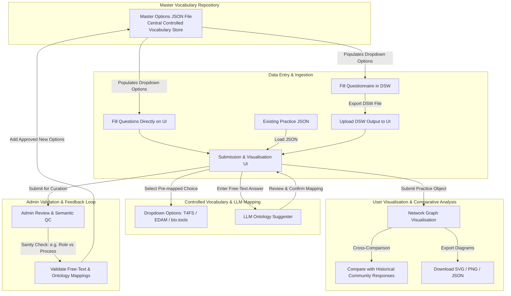

# Abstract

Interoperability practices developed within research projects, institutes, and scientific communities are often scattered across presentation slides, internal wikis, spreadsheets, and email threads. Because they are rarely documented in a consistent format, these practices are hard to find, compare, and reuse. In Project 5 at BioHackathon Europe 2026, we developed a self-service submission and visualisation workflow built around the RDMkit Data Life Cycle.

We reviewed an existing 41-question lifecycle survey and mapped its fields to relevant controlled vocabularies, ontologies, registries, and community standards. Based on this mapping, we designed a workflow that combines dropdown selections with free-text inputs and curator-reviewed term suggestions. Submitted practices can be exported in machine-readable formats (JSON and YAML) and explored across different visual views, while keeping the respondents' original descriptions intact. Hosted on GitHub Pages alongside public documentation, the platform gives communities an open, maintainable way to share, compare, and refine their interoperability practices.

# Introduction

Research communities regularly encounter the same practical challenges: capturing data and metadata, choosing identifiers and file formats, selecting tools, depositing outputs, and maintaining reproducibility. Because these practices are typically documented informally for local audiences, researchers and data stewards struggle to see how comparable domains handle similar tasks or which standards they apply.

An ongoing ELIXIR Interoperability Platform effort has been collecting these practices through guided interviews structured around the RDMkit Data Life Cycle. Having a facilitator helps respondents interpret the questions, but relying on one-on-one interviews and manual synthesis does not scale well. In Project 5, we set out to turn this interview process into a lightweight, self-service workflow that records practices in their community context and connects them to relevant resources such as FAIRsharing, bio.tools, software repositories, repository registries, standards, and ontologies.

Our work focused on six main objectives:

1. Convert the guided questionnaire into a self-service submission workflow.
2. Represent submitted practices in structured, machine-readable formats (JSON and YAML).
3. Link applicable fields to ontologies, registries, standards, databases, and role vocabularies.
4. Refine the DSW Knowledge Model integrating selected ontologies, registries, vocabolaries 
5. Define visual views ranging from high-level community overviews to detailed breakdowns of tasks, tools, inputs, outputs, and contributors.
6. Set up a review process so validated free-text answers can be added to the dropdown options for future submissions.

Target users include researchers looking for examples from similar domains, data stewards documenting local practices, community coordinators, and maintainers of RDM resources.

# Approach

## Design inputs and workstreams

Starting from the existing lifecycle questionnaire, synthesis spreadsheets, and mock examples, we divided the work into four tracks: (1) user interface and visualisation requirements, (2) mapping questions to controlled terms and registries, (3) a review process for adding vetted free-text answers to future dropdown menus, and (4) links to existing RDM resources.

## Questionnaire and terminology mapping

We went through each survey question to identify what concept it captures, what type of resource applies, and which controlled terms or registries could populate a dropdown menu or automated suggestion. These mappings are meant to supplement, not overwrite, the respondent's original wording, and they remain subject to human review.

## Submission and curation workflow

Users can enter data in three ways: by filling out the questionnaire in the Data Stewardship Wizard (DSW) and importing the output, by completing the form directly in the web interface, or by loading an existing JSON practice file. A central JSON file supplies the reviewed dropdown options to both DSW and the web interface.

When none of the listed options fit, respondents can enter free text. An LLM-assisted step suggests matching ontology or registry terms, which the user reviews before submitting. Before any new free-text terms are added to the shared options file, an administrator checks that they fit the question context—for instance, making sure a workflow step is not entered where a role is expected.



## Visualisation requirements

We defined four levels of detail for exploring the submitted practices:

1. **Community view:** An overview of a single community's practices across the RDM lifecycle.
2. **Multi-community view:** A side-by-side comparison across different domains or projects.
3. **Phase view:** A focused look at one or more selected lifecycle stages.
4. **Task view:** A detail card showing the tools, inputs, outputs, and roles for a specific task, along with both the mapped terms and the respondent's original text.

We also outlined supporting interface features, including a lifecycle wheel, search by topic or data type, visual markers for incomplete sections, and filtering by data type, role, community, or ELIXIR Node expertise.

# Results

## Questionnaire-to-resource mapping

We carried out an initial review of all 41 survey questions across the seven lifecycle stages, grouped them into seven resource categories (`database`, `tool`, `ontology`, `registry`, `individual document`, `community standard`, and `roles`), and linked each item to controlled vocabularies or registries (Table 1).

Table: Summary of questionnaire sections mapped to resource types and candidate vocabularies or registries.

| Lifecycle section | Target concepts | Resource types | Candidate ontologies and registries |
| :--- | :--- | :--- | :--- |
| **1. Plan** | Authoring tools, storage, validation, guidance, roles | tool, database, registry, individual document, community standard, roles | DSW, FAIRsharing, RDMkit, `T4FS` |
| **2. Collect** | Object types, formats, SOPs, persistent identifiers, QA roles | ontology, tool, community standard, registry, roles | EDAM (`format`), OLS, FAIRsharing, DataCite, `T4FS` |
| **3. Process** | Cleaning steps, standardisation, integrity checks, QC roles | tool, community standard, roles | EDAM (`operation`), OLS, WorkflowHub, `T4FS` |
| **4. Analyse** | Analytical methods, software, reproducibility, visualisation, training | ontology, tool, registry, community standard, roles | EDAM, SWO, bio.tools, ELIXIR TeSS, FAIR Cookbook |
| **5. Preserve** | Repositories, backups, archiving policies, certification | database, tool, individual document, community standard, roles | re3data, FAIRsharing, CoreTrustSeal, `T4FS` |
| **6. Share** | Shared objects, platforms, legal/ethical constraints, metadata | database, individual document, community standard, roles | Zenodo, ENA, DUO, Dublin Core, `T4FS` |
| **7. Reuse** | Reuse planning, standards, licences, discoverability | community standard, individual document, registry, roles | SPDX, DataCite, Schema.org, `T4FS` |

## Prototype implementation and GitHub-hosted deployment

We built an initial web prototype (`https://bh.bilgehan.nl/submit`) and matching DSW templates backed by the shared JSON options file. In the interface, users can compare their answers against previous submissions in a network view and export diagrams as SVG, PNG, or JSON files. We used test responses to prototype the LLM-based term suggester and the administrator review step.

To make it easier for the community to contribute new practices and help maintain the site through pull requests, we also deployed a GitHub Pages version of the submission interface (`https://biocorecrg.github.io/biohackathon-community-practices-2026/submit`) along with a documentation site (`https://biocorecrg.github.io/biohackathon-community-practices-2026/docs/`).

## Visualisation mockups and seed examples

We created UI mockups for the lifecycle wheel, search bar, greyed-out incomplete sections, and task detail cards.

# Discussion

## Cross-project alignment

Discussions with other BioHackathon projects helped clarify our data model and integration plans:

- **Credit and recognition (Project #6):** Conversations with Project #6 highlighted three open design questions for attribution: accounting for differences in a person's role and resourcing across a project, institute, or infrastructure; allowing multiple people or roles to be attached so credit is not limited to a single team representative; and crediting individual tasks and task components (such as specific tools used within a step) rather than only the whole submission.
- **Tool registries (Project #20):** Discussions with `bio.tools` developers focused on pushing tool-usage information from submitted practices to the registry, specifically which tool is used in a task and at which stage of the data lifecycle. While `bio.tools` already supports `EDAM:operation`, their team noted they may adjust their data model to better capture lifecycle context.
- **Semantic framework standards (Project #3):** We checked for overlap with Project #3 and identified their group as potential contributors of community practice records.

## Remaining decisions and next steps

1. **Refining the questionnaire-to-resource mapping:** Review and validate the initial mapping across all 41 questions with domain experts and ontology maintainers to confirm that the selected vocabularies, registries, and dropdown options fit each field.
2. **Syncing with existing RDM resources:** Set up automated workflows to exchange practice records and updated vocabulary lists between GitHub, RDMkit Tool Assemblies, DSW knowledge models, and FAIRsharing.
3. **Curation rules and production setup:** Move the LLM term-suggestion step into production and agree on clear review criteria for pull requests and new dropdown options.
4. **Broader testing and naming:** Add example practices from more domains, test the interface with data stewards, and choose a permanent name for the tool.

## Acknowledgements

We thank the BioHackathon Europe 2026 organisers, ELIXIR Europe, and the ELIXIR Interoperability Platform for supporting Project 5.

# References

```{=latex}
\AtEndDocument{%
}
```
