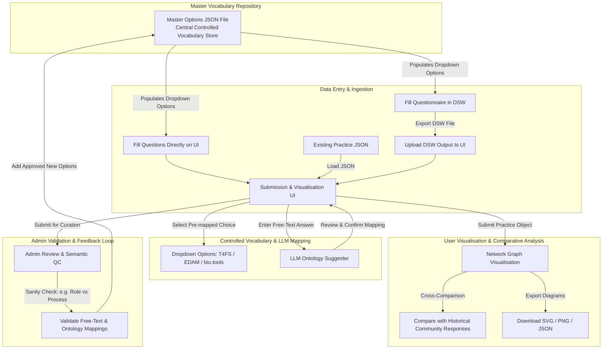
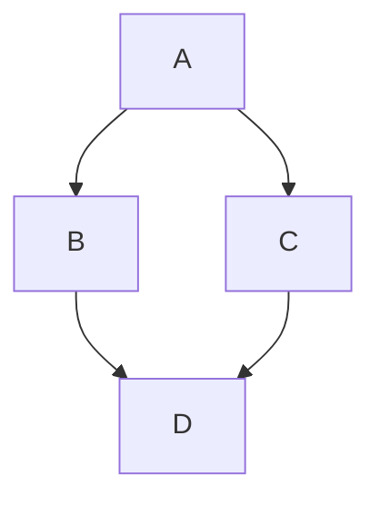

# Introduction

As part of BioHackathon Europe 2026 in Barcelona, Spain, we report on the development of a lightweight submission and visualization interface designed to share reference community practices across the research data management (RDM) ecosystem.

Scientific stakeholder groups across multi-node projects, research institutes, platforms, and domain communities often share interoperability practices as informal know-how embedded in presentation slides, internal wikis, or email threads. This unstructured distribution makes best practices difficult to discover, compare, validate, and reuse. Building on an ongoing ELIXIR Interoperability Platform (EIP) effort to capture community practices using the RDMkit Data Life Cycle framing, this project transitions manual "guided interview" questionnaires into an automated, self-service guided workflow.

By turning existing community inputs into structured, machine-actionable practice objects exported in JSON and rendered in human-friendly visualizations, this project provides a scalable framework to connect the distributed RDM ecosystem.

This document is the official report for Project 5 ("A submission and visualisation interface for sharing community interoperability practices"), developed during BioHackathon Europe 2026 in Barcelona, Spain.

## Scope and Vision
The primary goal of this project is to create an open-access reference resource where ELIXIR members, community champions, and data stewards can discover, contribute, improve, and reuse structured interoperability processes.



# Formatting

This document use Markdown and you can look at [this tutorial](https://www.markdowntutorial.com/).

## Subsection level 2

Please keep sections to a maximum of only two levels.

## Tables

Tables can be added in the following way, though alternatives are possible:

```markdown
Table: Note that table caption is automatically numbered and should be
given before the table itself.

| Header 1 | Header 2 |
| -------- | -------- |
| item 1 | item 2 |
| item 3 | item 4 |
```

This gives:

Table: Note that table caption is automatically numbered and should be
given before the table itself.

| Header 1 | Header 2 |
| -------- | -------- |
| item 1 | item 2 |
| item 3 | item 4 |

## Figures

A figure is added with:

```markdown

```

This gives:


Figures can be scaled by adding the width or height to the Markdown like this:

```markdown
{ width=50px }
```

You can add cross references to figures by adding a LaTeX `\label{figureCode}` to
the label of the Markdown figure and then use `\ref{figureCode}` to cite it:

```markdown
{ width=50px }
```

This way, we can cite Figure \ref{figureCode}.

## Mermaid graphs

[Mermaid](https://mermaid.js.org/) provides a solution to put diagrams in Markdown. BioHackrXiv
added support for this in 2026. This is an example of embedding a graph:



# Other main section on your manuscript level 1

Lists can be added with:

1. Item 1
2. Item 2

# Citation Typing Ontology annotation

You can use [CiTO](http://purl.org/spar/cito/2018-02-12) annotations, as explained in [this BioHackathon Europe 2021 write up](https://raw.githubusercontent.com/biohackrxiv/bhxiv-metadata/main/doc/elixir_biohackathon2021/paper.md) and [this CiTO Pilot](https://www.biomedcentral.com/collections/cito).
Using this template, you can cite an article and indicate _why_ you cite that article, for instance DisGeNET-RDF [@citesAsAuthority:Queralt2016].

The syntax in Markdown is as follows: a single intention annotation looks like
`[@usesMethodIn:Krewinkel2017]`; two or more intentions are separated
with colons, like `[@extends:discusses:Nielsen2017Scholia]`. When you cite two
different articles, you use this syntax: `[@citesAsDataSource:Ammar2022ETL; @citesAsDataSource:Arend2022BioHackEU22]`.

Possible CiTO typing annotation include:

* citesAsDataSource: when you point the reader to a source of data which may explain a claim
* usesDataFrom: when you reuse somehow (and elaborate on) the data in the cited entity
* usesMethodIn
* citesAsAuthority
* citesAsEvidence
* citesAsPotentialSolution
* citesAsRecommendedReading
* citesAsRelated
* citesAsSourceDocument
* citesForInformation
* confirms
* documents
* providesDataFor
* obtainsSupportFrom
* discusses
* extends
* agreesWith
* disagreesWith
* updates

There is a general `cites` intention, but this is already implied and should be left out.

# Results


# Discussion

...

## Acknowledgements

...

# References

```{=latex}
\AtEndDocument{%
```

# Appendices

If you want the Appendix (-ces) to show up after the references, wrap them in 
after the header, like done in this Markdown file. Look at the [source](paper.md)
to see the exact structure.

```{=latex}
}
```
