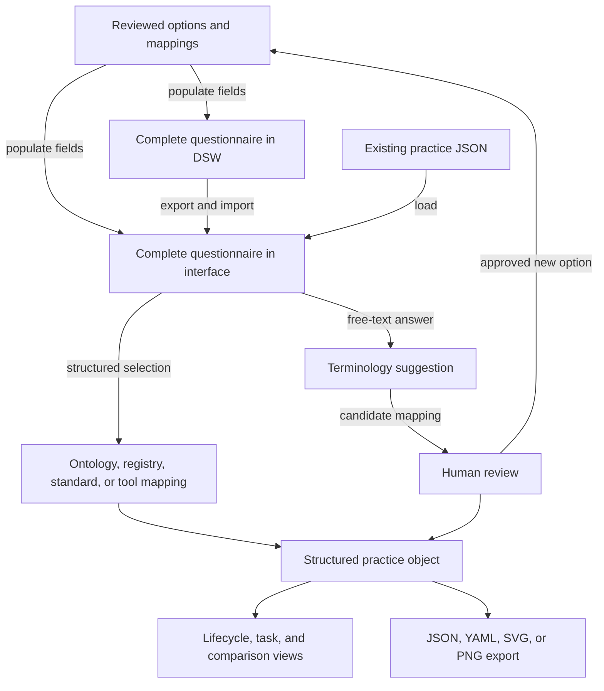
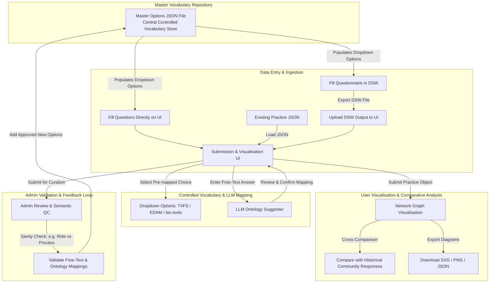
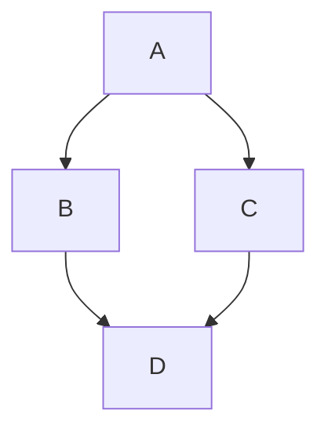

# Abstract

Interoperability practices developed by research projects, institutes, platforms, and scientific communities are often distributed across presentation slides, internal wikis, spreadsheets, and email threads. This makes the practices difficult to discover, compare, improve, and reuse. Project 5 at BioHackathon Europe 2026 addressed this problem by developing a submission and visualisation workflow for sharing structured community interoperability practices across the research data management ecosystem.

The project built on an existing questionnaire organised around stages of the RDMkit Data Life Cycle. The questionnaire captures the context of a practice, the tasks performed, the tools and resources used, the people or roles involved, and relevant constraints. During the BioHackathon, the team reviewed the questions to identify where registries, ontologies, controlled vocabularies, and community standards could support structured answers. The team also developed requirements for a user interface, considered routes for importing Data Stewardship Wizard output and existing JSON records, and designed visualisation levels ranging from an overview of a community practice to detailed views of lifecycle phases, tasks, tools, and contributions.

The resulting design combines controlled selections with free-text input and a proposed human-reviewed terminology-suggestion process. It supports machine-readable export and visual comparison while retaining the original community description. The work provides a foundation for a reference resource through which communities can submit, discover, compare, and iteratively improve interoperability practices.

# Introduction

Research communities repeatedly address similar operational questions: how data and metadata are captured, which identifiers and file formats are used, which tools support a task, how outputs are deposited, and how workflows can be reproduced. The resulting practices are frequently documented for a local audience rather than represented as reusable objects. Relevant information may be spread across slides, internal documentation, spreadsheets, and correspondence. Consequently, a researcher or data steward may find it difficult to determine what another community does for a comparable task or which standards and tools are already in use.

An ongoing ELIXIR Interoperability Platform activity has used guided interviews and a questionnaire structured around the RDMkit Data Life Cycle to capture such practices. The guided approach helps participants interpret the questions, but it limits scalability because completion depends on facilitator time and subsequent manual synthesis. Project 5 therefore set out to translate the interview process into a lightweight, self-service submission and visualisation workflow.

The project goal was not to define a single universal workflow. Instead, the intended resource records practices in their community and task context, connects answers to relevant FAIR-enabling resources where appropriate, and allows users to inspect similarities, differences, and gaps. Potentially linked resources include RDMkit, the FAIR Cookbook, FAIRsharing, bio.tools, software repositories, repository registries, community standards, and ontologies.

This report describes the design work, questionnaire mapping, prototype workflow, cross-project discussions, and remaining implementation decisions from BioHackathon Europe 2026 Project 5, “A submission and visualisation interface for sharing community interoperability practices.”

# Objectives and scope

The project had five objectives:

1. Convert the existing guided questionnaire into a workflow that stakeholders can complete directly.
2. Represent submitted practices in a structured form suitable for machine-readable export, initially JSON and YAML.
3. Identify questionnaire fields that can use controlled terms from ontologies, registries, community standards, databases, or role vocabularies.
4. Develop visualisation requirements that support both a community overview and detailed inspection of lifecycle phases, tasks, tools, inputs, outputs, and contributions.
5. Define a curation loop through which free-text answers and proposed mappings can be reviewed before becoming reusable options for later submissions.

The intended users include researchers seeking examples from comparable domains, data stewards looking for operational practices, community coordinators documenting a shared process, and maintainers of RDM ecosystem resources interested in linking practice descriptions to relevant guidance, standards, tools, and registries.

# Approach

## Starting materials and design inputs

The work started from the existing lifecycle-based survey questions, supporting spreadsheets, example answers, project slides, a sign-up sheet, and the project repository. The current process combines guided interviews with manual mapping and synthesis. The BioHackathon work examined how this process could be decomposed into reusable technical components without removing the context supplied by respondents.

The team organised the work into four connected streams:

1. Interface requirements and implementation.
2. Mapping questionnaire fields to ontologies, registries, databases, tools, documents, standards, and role vocabularies.
3. A feedback process in which reviewed answers can populate later dropdown menus.
4. Interlinking with the wider RDM ecosystem.

## Questionnaire and terminology mapping

Each questionnaire item was reviewed to identify: the concept that the question aims to capture; the type of resource that could support the answer; and candidate values, registries, standards, or ontologies suitable for a dropdown menu or suggested mapping. The resource categories included databases, tools, ontologies, registries, individual documents, community standards, and role vocabularies.

Examples considered during the mapping included EDAM for data and analysis operations, bio.tools for software resources, re3data for repositories, FAIRsharing for standards and databases, and role vocabularies for responsibility and contribution statements. The mapping was treated as a candidate layer for human review, not as an automatic replacement for a respondent’s original wording.

## Submission and curation workflow

The proposed workflow supports three entry routes: completion through the Data Stewardship Wizard followed by import; direct completion in the submission interface; and loading of an existing practice object represented in JSON. A master options file supplies reviewed values for structured fields.

Where a suitable reviewed option exists, the user selects it from a dropdown menu. Where no suitable option exists, the user enters free text. A terminology-suggestion component may propose candidate mappings, but the user or curator must review the suggestion. New values are added to the master options only after semantic and contextual review. This is intended to reduce mismatches such as assigning a role term to a process or treating a software resource as a standard.





# Formatting

This document use Markdown and you can look at [this tutorial](https://www.markdowntutorial.com/).

## Subsection level 2

Please keep sections to a maximum of only two levels.

## Tables

Tables can be added in the following way, though alternatives are possible:

```markdown
Table: Note that table caption is automatically numbered and should be
given before the table itself.

| Header 1 | Header 2 |
| -------- | -------- |
| item 1 | item 2 |
| item 3 | item 4 |
```

This gives:

Table: Note that table caption is automatically numbered and should be
given before the table itself.

| Header 1 | Header 2 |
| -------- | -------- |
| item 1 | item 2 |
| item 3 | item 4 |

## Figures

A figure is added with:

```markdown

```

This gives:


Figures can be scaled by adding the width or height to the Markdown like this:

```markdown
{ width=50px }
```

You can add cross references to figures by adding a LaTeX `\label{figureCode}` to
the label of the Markdown figure and then use `\ref{figureCode}` to cite it:

```markdown
{ width=50px }
```

This way, we can cite Figure \ref{figureCode}.

## Mermaid graphs

[Mermaid](https://mermaid.js.org/) provides a solution to put diagrams in Markdown. BioHackrXiv
added support for this in 2026. This is an example of embedding a graph:



# Other main section on your manuscript level 1

Lists can be added with:

1. Item 1
2. Item 2

# Citation Typing Ontology annotation

You can use [CiTO](http://purl.org/spar/cito/2018-02-12) annotations, as explained in [this BioHackathon Europe 2021 write up](https://raw.githubusercontent.com/biohackrxiv/bhxiv-metadata/main/doc/elixir_biohackathon2021/paper.md) and [this CiTO Pilot](https://www.biomedcentral.com/collections/cito).
Using this template, you can cite an article and indicate _why_ you cite that article, for instance DisGeNET-RDF [@citesAsAuthority:Queralt2016].

The syntax in Markdown is as follows: a single intention annotation looks like
`[@usesMethodIn:Krewinkel2017]`; two or more intentions are separated
with colons, like `[@extends:discusses:Nielsen2017Scholia]`. When you cite two
different articles, you use this syntax: `[@citesAsDataSource:Ammar2022ETL; @citesAsDataSource:Arend2022BioHackEU22]`.

Possible CiTO typing annotation include:

* citesAsDataSource: when you point the reader to a source of data which may explain a claim
* usesDataFrom: when you reuse somehow (and elaborate on) the data in the cited entity
* usesMethodIn
* citesAsAuthority
* citesAsEvidence
* citesAsPotentialSolution
* citesAsRecommendedReading
* citesAsRelated
* citesAsSourceDocument
* citesForInformation
* confirms
* documents
* providesDataFor
* obtainsSupportFrom
* discusses
* extends
* agreesWith
* disagreesWith
* updates

There is a general `cites` intention, but this is already implied and should be left out.

# Results


# Discussion

...

## Acknowledgements

...

# References

```{=latex}
\AtEndDocument{%
```

# Appendices

If you want the Appendix (-ces) to show up after the references, wrap them in 
after the header, like done in this Markdown file. Look at the [source](paper.md)
to see the exact structure.

```{=latex}
}
```
